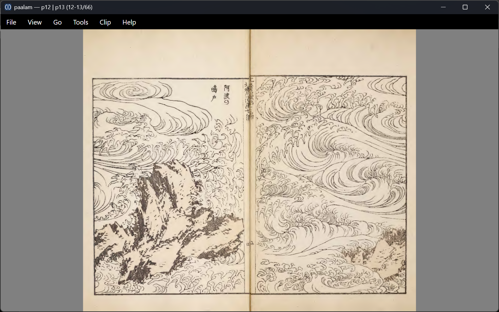
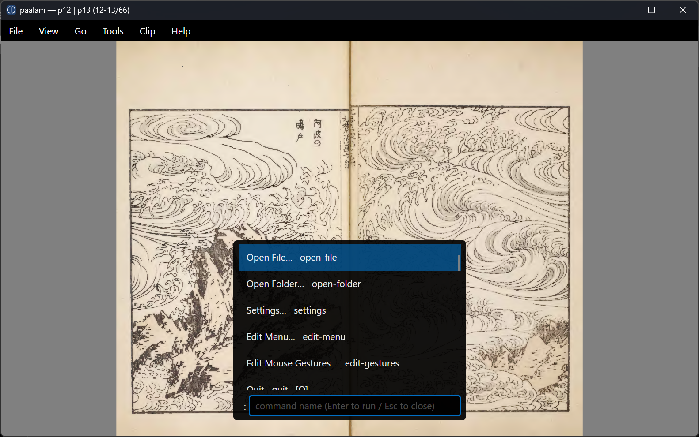

# paalam

*English / [日本語](README.ja.md)*

**A NeeView-style image / comic / PDF viewer written with [dotcl](https://github.com/dotcl/dotcl) (Common Lisp on .NET) and [Avalonia](https://avaloniaui.net/).**

*"paalam" means "goodbye" / "farewell" in Tagalog.*



<p align="center">


</p>

<sub>Screenshots: <a href="https://archive.org/details/hokusaimanga07kats"><em>Hokusai Manga</em> vol. 7</a> (1912 printing, public domain, via the Internet Archive), opened directly as a PDF book with right-to-left binding.</sub>

Almost everything — both the UI and the application logic — is written in Common Lisp (under `src/`, split by feature). The C# side (a single `Program.cs`) only handles boot and a thin slice of interop. The same code runs cross-platform as a GUI on Windows / macOS / Linux.

> This project doubles as a technical demo of **how far you can push a practical GUI app in dotcl**. Read it as a worked example of "build an Avalonia `Window` from Common Lisp, express the domain model with CLOS, and prefetch on Lisp threads."

## What makes it different

- **The GUI is written in Common Lisp** — even the `Avalonia.Application` subclass is emitted from Lisp via `dotnet:define-class` (`Paalam.App`). Assembling `Window` / `Grid` / `Image`, wiring events, posting to the Dispatcher — all on the Lisp side.
- **C# is only a thin boundary** — `Program.cs` (one file) preloads the Avalonia assemblies, loads the precompiled Lisp from a manifest, and calls `RUN-PAALAM`. What remains is just the interop that's simply easier to leave to managed libraries: PDF rasterization (`PdfDoc`, PDFtoImage/SkiaSharp), EXIF extraction (`Exif`, MetadataExtractor), native file dialogs (`DialogHelper`), and a macOS rendering fix (`MacRenderFix`). Note that PDF text / metadata / outline extraction has **migrated from the former C# shim `Paalam.PdfText` (P/Invoke) to Lisp FFI** (`src/pdf-ffi.lisp`, `dotnet:ffi`) — even raw native calls can be written on the Lisp side.
- **Lisp is ahead-of-time compiled at build time** — `DotCL.Runtime`'s project-core build (`<DotclProjectAsd>`) compiles the ASDF system (`src/paalam.asd`) to fasl in-process at build time and places the dependency fasls + manifest in the output. At runtime there are no sources shipped and no `compile-file` — it loads in one shot.
- **A book protocol** — the source of pages (directory / zip / rar・7z・tar / PDF) is abstracted behind a CLOS protocol (`directory-book` / `zip-book` / `sharp-book` / `pdf-book`), independent of the GUI.

## Features

- Two-page spread / single-page view, with toggleable binding direction: right-to-left (manga) or left-to-right
- Fit modes (whole / width / height) + cursor-centered wheel zoom and panning
- Supported formats: image folders (HEIC/HEIF too, decoded via [SkiaSharp.Heic](https://www.nuget.org/packages/SkiaSharp.Heic)), zip/cbz, rar/cbr・7z/cb7・tar/cbt ([SharpCompress](https://github.com/adamhathcock/sharpcompress)), PDF ([PDFtoImage](https://github.com/sungaila/PDFtoImage) / PDFium)
- Prefetching loader — a background worker thread caches decoded Bitmaps, so even archives on a NAS page smoothly
- Page-thumbnail shelf / folder-tree shelf / file-info & EXIF side pane
- History (remembers the last page per book and resumes) + bookmarks
- PDF full-text search (`/`) with in-page highlighting of hits
- Clips — collect pages into named sets and export them to a zip
- Drag & drop to open a book
- Command palette (`:`) and customizable key bindings (settings window)

## Build and run

Requires: **.NET 10 SDK**.

```sh
make build                          # or: dotnet build
make run                            # or: dotnet run
make run ARGS=/path/to/manga.zip    # pass a folder / archive / image / PDF
```

You can also pass the target directly, e.g. `dotnet run -- /path/to/manga.zip`.
The `PAALAM_PATH` environment variable can specify the target as well.

## Key bindings (defaults)

| Key | Action |
|---|---|
| `←` / `→` | Read forward / backward (follows binding direction) |
| `Space` `J` `PageDown` / `K` `PageUp` | Next spread / previous spread |
| `Home` / `End` | First / last |
| `[count]g` `gg` / `G` | Go to page / first / last |
| `S` / `D` | Toggle spread / toggle binding direction |
| `W` / `0` | Cycle fit mode / reset to fit |
| `F` `F11` | Fullscreen |
| `R` | Toggle recursive collection |
| `T` / `L` / `P` / `I` | Thumbnail shelf / folder shelf / clip pane / info panel |
| `A` / `E` | Add to clip / export clip to zip |
| `B` / `[` / `]` | Toggle bookmark / previous bookmark / next bookmark |
| `/` | Search (PDF full-text / filename). `n` / `N` to cycle hits |
| `:` | Command palette |
| `Esc` | Back / quit |

Keys can be changed in the settings window and are persisted to `keymap.lisp`.

## Architecture

```
Program.cs (C#)                  src/*.lisp (Common Lisp)
───────────────                  ─────────────────────────
Main()                           (defun run-paalam ...)
  preload Avalonia assemblies  →    AppBuilder.Configure<Paalam.App>()
  DotclHost.LoadFromManifest()       .UsePlatformDetect()
  DotclHost.Call("RUN-PAALAM")       .StartWithClassicDesktopLifetime()
                                 (dotnet:define-class "Paalam.App" ...)
PdfDoc    PDFium rasterization     OnFrameworkInitializationCompleted
Exif      EXIF (MetadataExtractor)  → build-main-window → Window
DialogHelper / MacRenderFix      book protocol (CLOS)
                                 pdf-ffi  PDFium text/meta FFI (dotnet:ffi)
                                 prefetching loader (dotcl-thread)
```

At build time `src/paalam.asd` is AOT-compiled to fasl, and the dependency fasls +
`dotcl.core` + manifest (`dotcl-deps.txt`) are emitted to `bin/.../dotcl-fasl/`. At
runtime `Program.cs` just bulk-loads the manifest (no sources shipped).

## Dependencies

NuGet references only (no source dependency on the dotcl repo):

- `DotCL.Runtime` — the Common Lisp runtime + project-core build
- `Avalonia` / `Avalonia.Desktop` / `Avalonia.Themes.Fluent`
- `SharpCompress` (archives) / `PDFtoImage` (PDF) / `SkiaSharp.Heic` (HEIC/HEIF)
- `MetadataExtractor` (EXIF / metadata, info panel)

## Windows installer

```powershell
# Requires Inno Setup 6: winget install --id JRSoftware.InnoSetup
make win-installer                                       # both x64 + arm64
powershell -File packaging\windows\build.ps1 -Arch x64  # one arch only
```

This produces `dist\paalam-setup-<arch>.exe`. It's a **per-user install**
(`%LOCALAPPDATA%\Programs\paalam`, no admin rights required), with a Start Menu
shortcut and an uninstaller. The payload is a self-contained publish output, so it
runs even on machines without the .NET runtime installed.

File associations are not set up by the installer (the policy is to leave that to
the app's in-app per-user association). The scripts themselves are under
`packaging/windows/` (`paalam.iss` + `build.ps1`).

## macOS .app bundle

```sh
make app        # produces dist/paalam.app
open dist/paalam.app
```

The bundle is self-contained (the .NET runtime is bundled), so the target machine
needs no runtime installed. (A framework-dependent build breaks when launched from
Finder: a double-click doesn't inherit shell env vars like `DOTNET_ROOT`, so it can
fail to find the runtime before reaching `Main`.) The `.app` is
unsigned (it launches fine for use on your own machine). To distribute it to others
you additionally need Developer ID signing + notarization, and the recipient may
need to clear the quarantine attribute (`xattr -dr com.apple.quarantine paalam.app`).

The bundle-building logic lives under `packaging/macos/` (`make-app.sh` +
`Info.plist.in`).

## Linux (AppImage / tar.gz)

```sh
make appimage   # produces dist/paalam-<version>-<arch>.AppImage (self-contained)
make tarball    # produces dist/paalam-<version>-<arch>.tar.gz (with install.sh)
```

Both produce self-contained output (the .NET runtime is bundled), so the target
machine needs no runtime. The tarball ships an XDG-compliant `install.sh` /
`uninstall.sh` that installs under `~/.local/`. The RID (`linux-x64` /
`linux-arm64`) is auto-detected from the host. Scripts live under `packaging/linux/`.

## License

[MIT](LICENSE) © SANO Masatoshi
